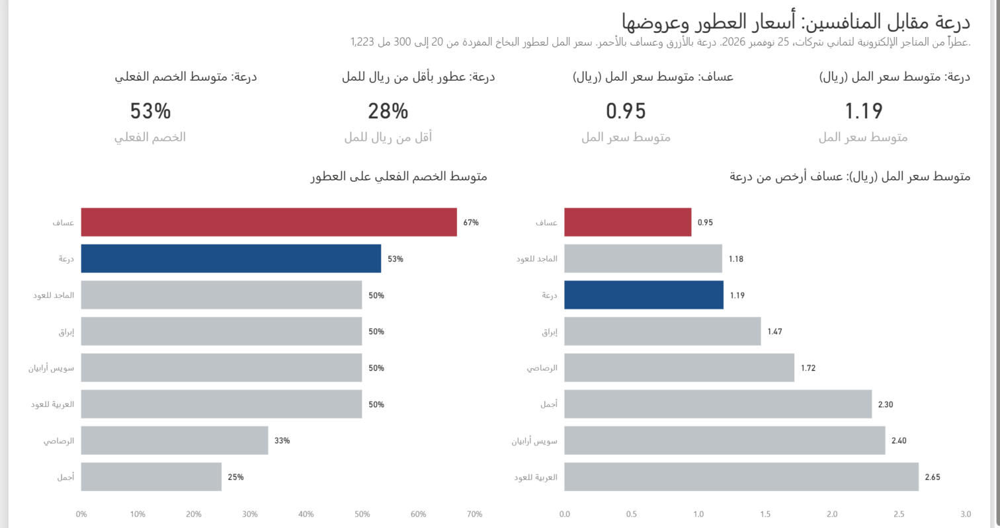
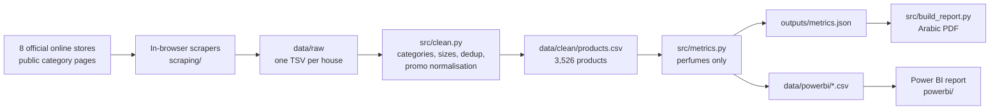
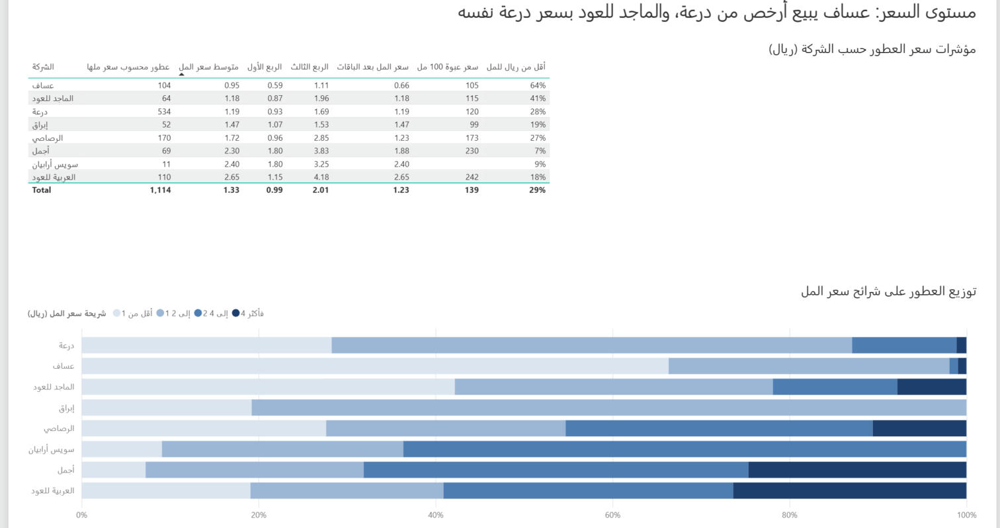
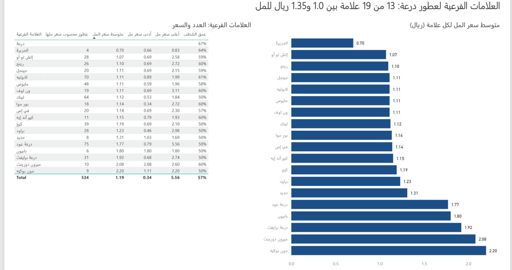
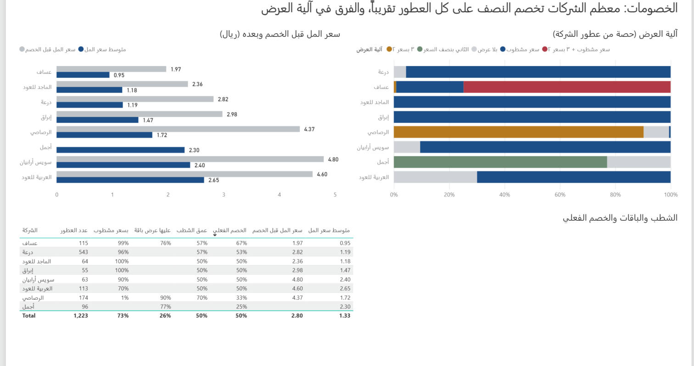
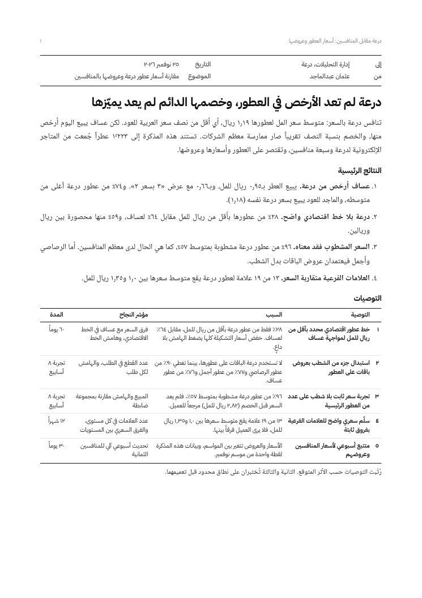

# Deraah vs Competitors: Perfume Prices and Discounts

How Deraah's perfume prices and promotions compare with seven Saudi competitors, built from a one-day scrape of eight official online stores: 1,223 perfumes, priced per ml so that bottles of different sizes can be compared.

**Stack:** JavaScript (in-browser scraping) · Python, pandas (cleaning and metrics) · Power BI (TMDL model, DAX, PBIP project format) · HTML to PDF (Arabic report)

**Data:** Public category pages of each company's official online store, captured on 25 November 2026 (the November sale season). Houses: Deraah, Assaf, Al Majed Oud, Ibraq (Ibrahim Al Qurashi), Rasasi, Swiss Arabian, Ajmal, Arabian Oud.

**Read first:** [`report/deraah_perfume_pricing_ar.pdf`](report/deraah_perfume_pricing_ar.pdf), a five-page memo in Arabic. Summary in Arabic: [README.ar.md](README.ar.md).



## The questions

1. Is Deraah still the cheapest perfume house in its segment?
2. How is Deraah's range spread across price levels, and do its sub-brands sit at distinct prices?
3. How deep are the discounts, and how does each house deliver them?

## Headline results

| House | Perfumes priced per ml | Median SAR per ml | After multi-buy offers | 100 ml bottle (SAR) | Share under 1 SAR/ml |
|---|---:|---:|---:|---:|---:|
| Assaf | 104 | 0.95 | 0.66 | 105 | 64% |
| Al Majed Oud | 64 | 1.18 | 1.18 | 115 | 41% |
| **Deraah** | **534** | **1.19** | **1.19** | **120** | **28%** |
| Ibraq | 52 | 1.47 | 1.47 | 99 | 19% |
| Rasasi | 170 | 1.72 | 1.23 | 173 | 27% |
| Ajmal | 69 | 2.30 | 1.88 | 230 | 7% |
| Arabian Oud | 110 | 2.65 | 2.65 | 242 | 18% |

**Deraah is no longer the cheapest.** Assaf's median perfume costs 0.95 SAR per ml against Deraah's 1.19, and 0.66 with its "3 for 2" offer. 74% of Deraah's perfumes are priced above Assaf's median. Al Majed Oud sells at Deraah's level.

**Deraah has no clear entry tier.** 28% of its perfumes are under 1 SAR per ml, against 64% for Assaf. 59% sit between 1 and 2 SAR per ml. Of Deraah's 19 perfume sub-brands, 13 have a median between 1.00 and 1.35 SAR per ml, so they are not separated by price.

**The struck-through price no longer means much.** 96% of Deraah's perfumes carry a struck-through price, with a median cut of 57%. Six of the eight houses discount by half or more. Rasasi (90% of perfumes) and Ajmal (77%) use multi-buy offers instead; Assaf stacks both. Deraah runs no multi-buy offers on perfumes.

| House | Struck-through | Multi-buy offer | Effective discount | Mechanism |
|---|---:|---:|---:|---|
| Assaf | 99% | 76% | 67% | Struck-through price plus "3 for 2" |
| **Deraah** | **96%** | **0%** | **53%** | **Struck-through price** |
| Al Majed Oud | 100% | 0% | 50% | % badge |
| Ibraq | 100% | 0% | 50% | % badge |
| Swiss Arabian | 90% | 0% | 50% | Struck-through price |
| Arabian Oud | 70% | 0% | 50% | Struck-through price on part of the range |
| Rasasi | 1% | 90% | 33% | "3 for 2" |
| Ajmal | 0% | 77% | 25% | Second item half price |

## Recommendations

| | Recommendation | Measure of success |
|---|---|---|
| 1 | A defined entry line under 1 SAR per ml to answer Assaf, rather than cutting prices across the range | Price gap to Assaf in the entry line; margin of the line |
| 2 | Replace part of the struck-through discounting with multi-buy offers on perfumes (8-week test) | Units per order; margin per order |
| 3 | Test a fixed price with no struck-through price on a few core perfumes (8-week test against a control group) | Units and margin against control |
| 4 | A clear price ladder for the sub-brands, with fixed gaps between tiers | Sub-brands per tier; price gap between tiers |
| 5 | A weekly tracker of competitor prices and offers, built on this pipeline | Automated weekly refresh |

The recommendations draw on Bain's work on discounting and everyday pricing, McKinsey's on private-brand architecture, and the Saudi Ministry of Commerce rules on licensed discounts. Sources are listed in the report.

## How it works



### Definitions

| Term | Definition |
|---|---|
| Perfume | Single spray perfume. Oils, incense, gift sets, body and hair mists, home fragrance and accessories are excluded |
| Price per ml | Selling price divided by bottle size, for single bottles of 20 to 300 ml |
| Price after multi-buy offers | Price per ml less the value of "3 for 2" (one third) or "second item half price" (one quarter), if the shopper buys the required quantity |
| Effective discount | Struck-through price or % badge: the difference between the two prices. "3 for 2": 33%. "Second item half price": 25%. When a struck-through price and "3 for 2" apply together (Assaf), both are counted |
| Median | All "average" figures are medians, so a few very expensive or very cheap bottles do not move them |

### Cleaning decisions

- **Sizes.** Taken from the product name or page. For Deraah perfumes with no size in the name, the size comes from the last three digits of the product code; this matched the stated size in 99.3% of 411 products where both were known.
- **Duplicates.** Deraah lists some products more than once (for example one page per size or colour). Pages with the same name, size and price are collapsed into one product.
- **Al Majed list price.** The card shows the sale price and a % badge, not the old price. The list price is derived from the badge (checked by hand: 149 SAR with a 50% badge matches the 298 SAR shown on the product page).
- **Assaf sets.** Assaf uses "مجموعة" (collection) for multi-bottle sets, so those names are classed as gift sets. Deraah uses the same word for a product line, so the rule applies to Assaf only.
- **Unreadable prices.** 13 Assaf items were read with a price of zero and are dropped.

## Limitations

- **One day, in the sale season.** Discounts in a normal month may be smaller. The weekly tracker in recommendation 5 is what turns this into a trend.
- **Online prices only.** Branch prices may differ.
- **No sales data.** Nothing here says which prices sell. Deraah's product cards show "viewed recently" and "sold recently" counters, but their time window is not stated and competitors do not show them, so they are not used. Measuring the recommendations needs Deraah's internal sales.
- **Swiss Arabian** publishes the size for 11 of its 63 perfumes, so it is left out of price-per-ml comparisons.
- **Not covered:** Abdul Samad Al Qurashi (the second-largest house by market share) and Dkhoni, whose stores could not be reached during the scrape.

## Run it

Requires Python 3.10+, and Power BI Desktop to open the report.

To look at the results without rebuilding, open `report/deraah_perfume_pricing_ar.pdf`, or open `powerbi/Deraah_Pricing.pbip` and select **Refresh**. If the project is not in `C:\Users\USER\Documents\Projects\deraah_market_analysis\deraah-perfume-pricing`, change the `DataFolder` parameter first (Transform data, then Edit parameters) to the full path of `data\powerbi\`.

To rebuild from the raw files:

```
pip install -r requirements.txt
playwright install chromium
python src/clean.py
python src/metrics.py
python src/build_report.py
```

`clean.py` rewrites `data/clean/products.csv`; `metrics.py` rewrites `outputs/metrics.json` and `data/powerbi/*.csv`; `build_report.py` rewrites the PDF.

The raw files were captured with the scripts in `scraping/`, run in the browser console on each store's public category pages. See [scraping/README.md](scraping/README.md).

## Repository

```
scraping/
  salla_scrape.js           product cards on Salla stores (Assaf, Al Majed, Ibraq, Rasasi, Arabian Oud)
  extract_dump.py           turns a saved scrape into a TSV
  README.md                 how each store was captured
data/
  raw/                      one TSV per house, as captured
  clean/products.csv        all products, one row each, 29 columns
  powerbi/                  perfumes fact table and two dimensions, read by Power BI
src/
  clean.py                  raw to clean
  metrics.py                perfume metrics and Power BI tables
  build_report.py           Arabic PDF report
  report_style.py           report layout and type
  build_powerbi.py          first draft of the Power BI project (TMDL and report pages)
powerbi/
  Deraah_Pricing.pbip       open this
  Deraah_Pricing.SemanticModel/  model, relationships, 16 DAX measures (TMDL)
  Deraah_Pricing.Report/    5 pages (PBIR)
report/
  deraah_perfume_pricing_ar.pdf
fonts/                      IBM Plex Sans Arabic, Noto Naskh Arabic (SIL Open Font License)
docs/                       screenshots
```

## The report

| Page | What it answers |
|---|---|
| Summary | Where does Deraah stand on price and discount? |
| Price level | How do the houses compare per ml, and how is each range spread across price bands? |
| Deraah sub-brands | Are Deraah's sub-brands separated by price? |
| Discounts | How deep are the discounts, and through which mechanism? |
| Method | How the numbers were built and what they leave out |

**Price level**



**Deraah sub-brands**



**Discounts**



## The PDF



---

Osman Abdelmagid (عثمان عبدالماجد) · November 2026
